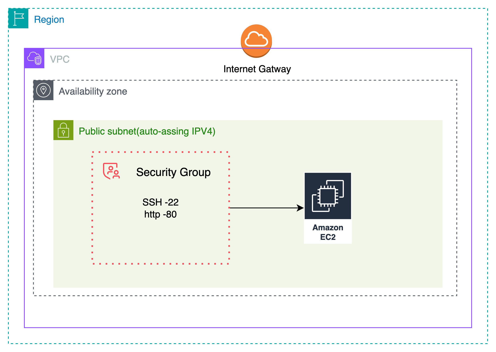
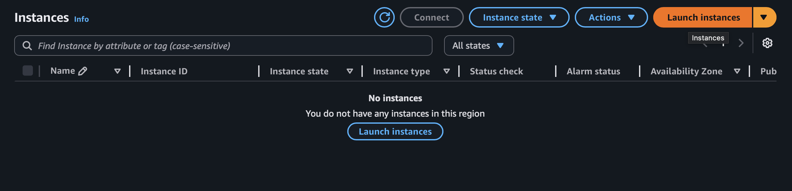
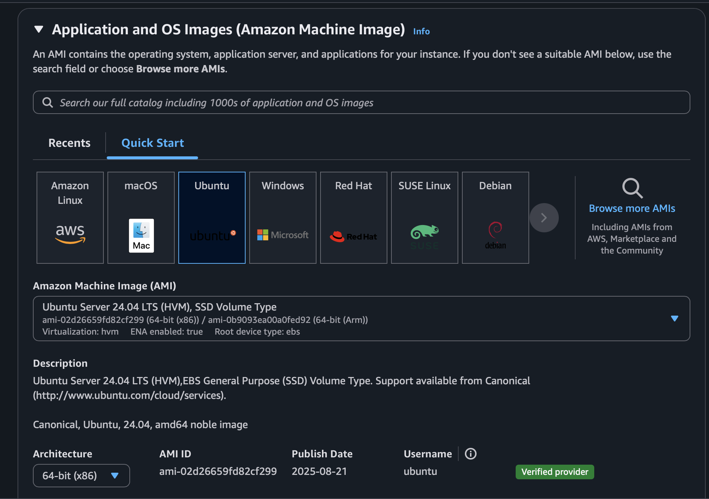
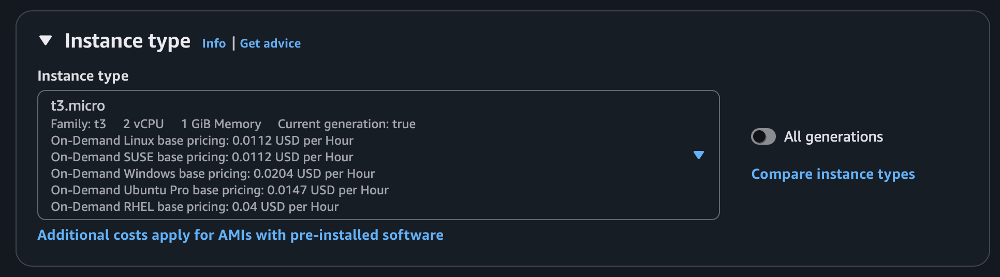
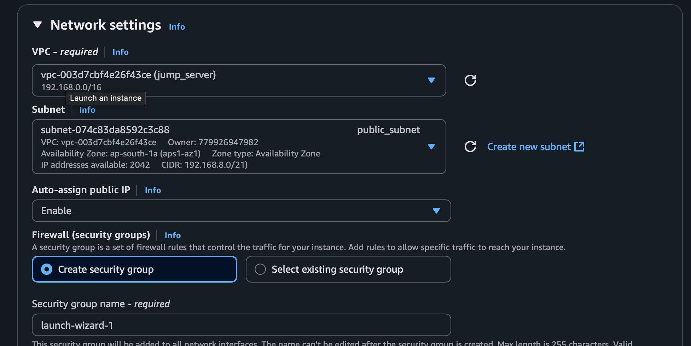
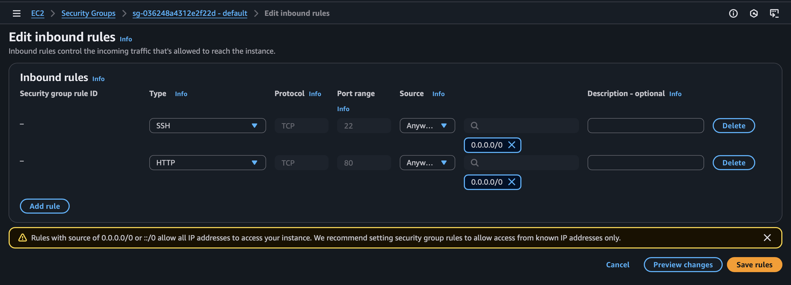
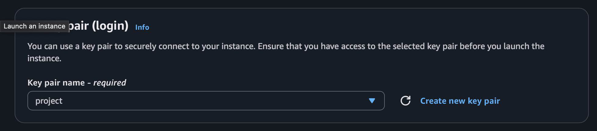
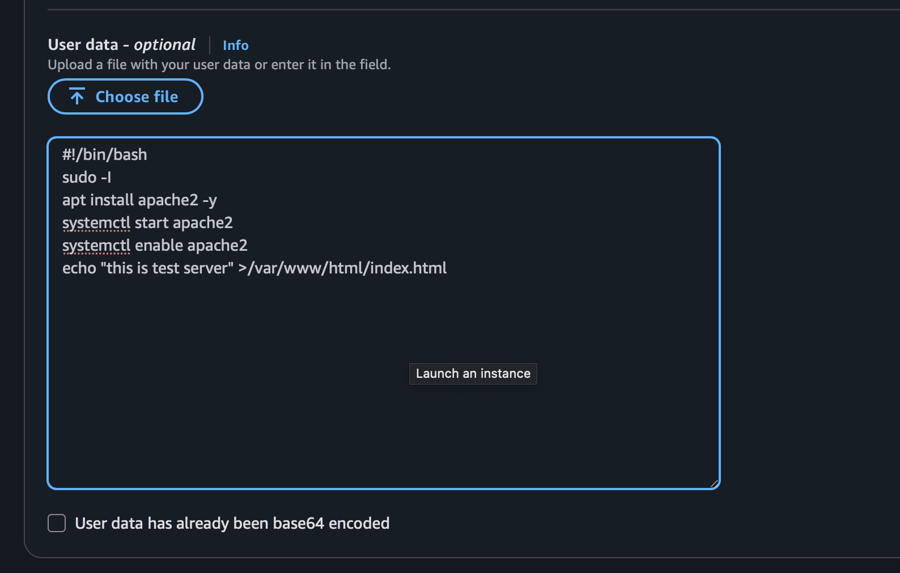
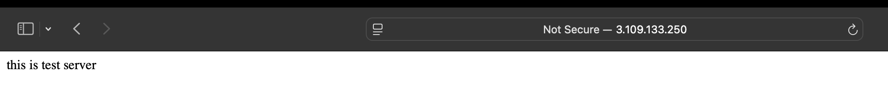
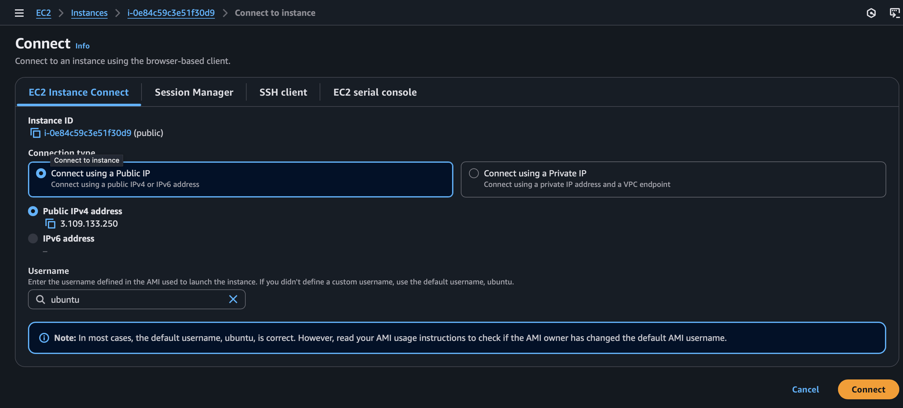

The goal of this lab is to launch a single EC2 instance in a public subnet that is accessible from the Internet via SSH.

## Architecture Diagram



## Overview

 In order to achieve the goal of this lab, you will have to go through the following steps:


1. Choose the operating system by selecting the [Amazon Machine Image (AMI)](https://docs.aws.amazon.com/AWSEC2/latest/UserGuide/AMIs.html).

2. Define the virtual hardware configuration by choosing an [Instance Type](https://docs.aws.amazon.com/AWSEC2/latest/UserGuide/instance-types.html).


3. Review the network settings.
check weather auto assing public ip is on or not --> enable


4. Review the storage settings.
5. Create tags (optional).

6. Configure the [Security Group](https://docs.aws.amazon.com/vpc/latest/userguide/VPC_SecurityGroups.html) rules (firewall).


7. Launch the instance (choosing or creating an [EC2 key pair](https://docs.aws.amazon.com/AWSEC2/latest/UserGuide/ec2-key-pairs.html)).


8. advance option run simple bash script
   
 ```bash
#!/bin/bash 
sudo -i
apt update -y 
apt install apache2 -y 
systemctl start apache2 
systemctl enable apache2 
echo "this is test server $HOSTNAME" >/var/www/html/index.html
```
## nginx 
```bash
#!/bin/bash
sudo -i 
apt update -y
apt install nginx -y
systemctl start nginx 
systemctl enable nginx
echo "this is test server " >/var/www/html/index.html
```
## Index.html page code 
```index.html
<!DOCTYPE html>
<html lang="en">
<head>
<meta charset="UTF-8">
<title>Minimalist Clone</title>
<meta name="viewport" content="width=device-width, initial-scale=1.0">

<style>
*{margin:0;padding:0;box-sizing:border-box;font-family:Arial}
.top-banner{background:#f7941d;color:#fff;text-align:center;padding:10px}
.navbar{display:flex;justify-content:space-between;padding:20px 40px;border-bottom:1px solid #eee}
.nav-links{display:flex;gap:20px}
.hero{display:flex;justify-content:space-between;align-items:center;padding:50px}
.hero img{width:350px;border-radius:10px}
.btn{background:black;color:white;padding:10px 15px;border:none}
.products{display:grid;grid-template-columns:repeat(4,1fr);gap:20px;padding:40px}
.card{background:#f5f5f5;padding:20px;text-align:center;border-radius:10px}
.card img{width:100%;height:180px;object-fit:cover}
h2{padding-left:40px}
</style>
</head>

<body>

<div class="top-banner">Enjoy free shipping on every order!</div>

<div class="navbar">
  <h2>Minimalist</h2>
  <div class="nav-links">
    <span>Shop</span>
    <span>Best Sellers</span>
    <span>Skin & Body Care</span>
    <span>Hair Care</span>
  </div>
</div>

<div class="hero">
  <div>
    <h1>Welcome to TrustCircle</h1>
    <p>We value your loyalty to skincare.</p>
    <button class="btn">Shop Now</button>
  </div>

  <!-- WORKING HERO IMAGE -->
  

  <div>
    <h2>Enjoy <br>5% Cashback</h2>
  </div>
</div>

<h2>Our Best Sellers</h2>

<div class="products">

  <div class="card">
    
    <p>Face Cleanser</p>
  </div>

  <div class="card">
    
    <p>Sunscreen SPF 50</p>
  </div>

  <div class="card">
    
    <p>Vitamin B5 Moisturizer</p>
  </div>

  <div class="card">
    
    <p>Face Serum</p>
  </div>

</div>

</body>
</html>
```


9. server check
   
10. if want to connect to instance click on connect
    
    
