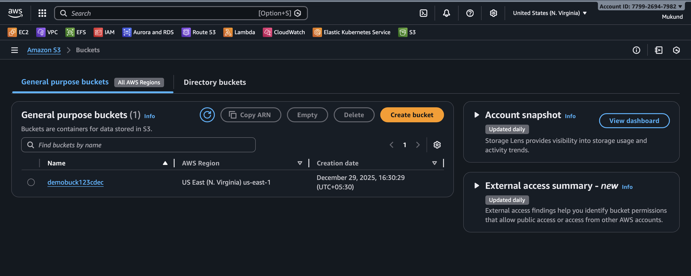
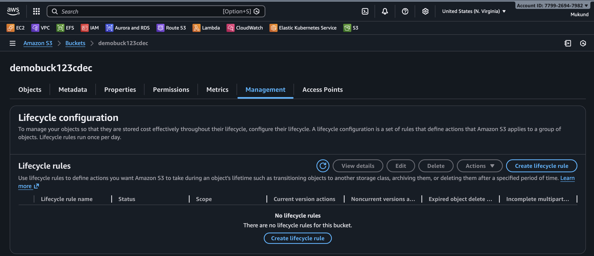
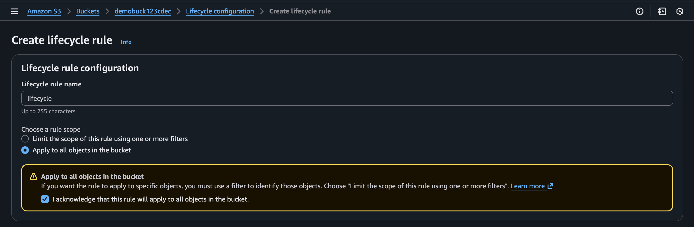
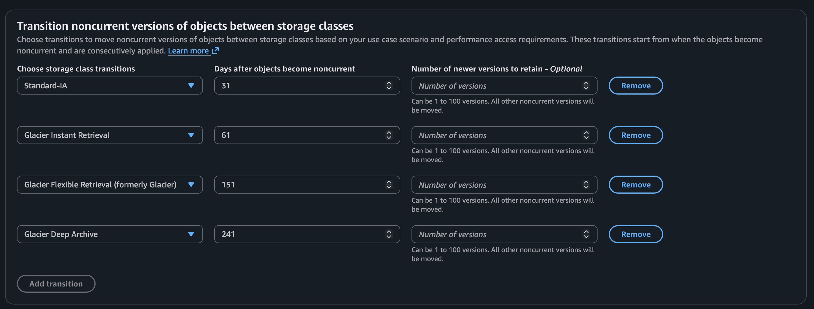
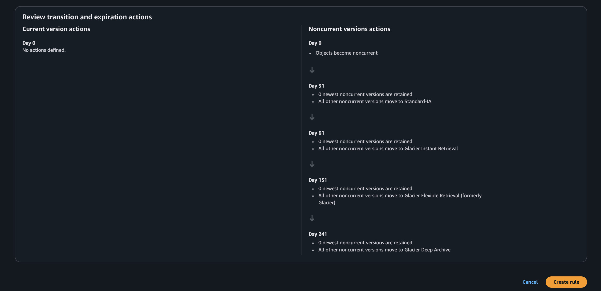
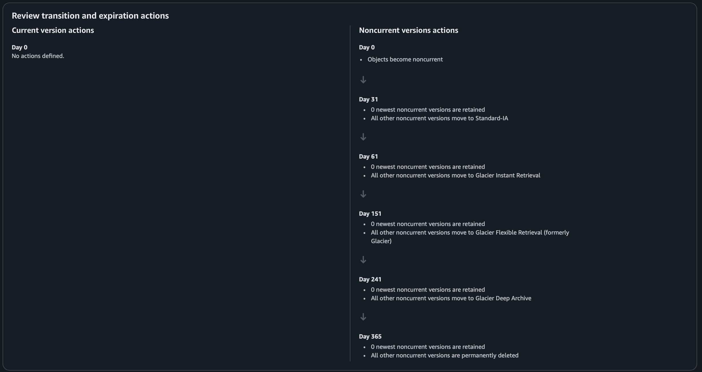
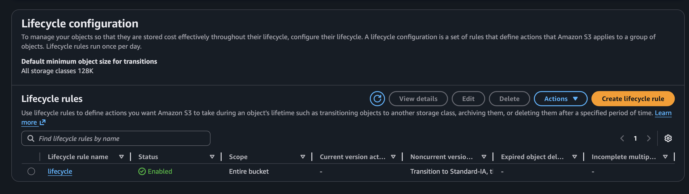

## Introduction to S3 Lifecycle Rule

Amazon S3 Lifecycle Rule is a cost-optimization and data-management feature that automatically manages objects stored in an S3 bucket throughout their lifetime. Lifecycle rules allow you to define actions such as transitioning objects to cheaper storage classes, archiving data, and deleting objects after a specific time period.

By using lifecycle rules, organizations can reduce storage costs, improve data governance, and eliminate manual cleanup tasks. Lifecycle configurations run automatically once per day and apply to either the entire bucket or selected objects based on prefixes and tags.

Lifecycle rules are commonly used for managing application logs, database backups, temporary uploads, compliance records, and archival data. They help ensure that data is stored in the most cost-effective storage class based on its access pattern and retention requirement.

# Steps to Configure S3 Lifecycle Rule

### Step 1: Open Amazon S3
Log in to AWS Management Console and open the **Amazon S3** service.

### Step 2: Select Bucket
Click on the S3 bucket where you want to apply lifecycle rules.

### Step 3: Open Management Tab
Navigate to the **Management** tab of the selected bucket.

### Step 4: Open Lifecycle Rules
Scroll to the **Lifecycle rules** section and click **Create lifecycle rule**.

### Step 5: Enter Rule Details
- Enter a **Lifecycle rule name**
- Select **Apply to all objects in the bucket**

### Step 6: Configure Transition Rules

| Days After Upload | Storage Class |
|------------------|---------------|
| 30 Days | Standard-IA |
| 90 Days | Glacier |
| 180 Days | Deep Archive |

Enable:
- Apply to **current versions**
- Apply to **non-current versions**

### Step 7: Configure Expiration

### Step 8: Review and Create Rule
Review all settings and click **Create rule**.

### Step 9: Verify Rule
Confirm the rule status is **Enabled** under Lifecycle rules.

