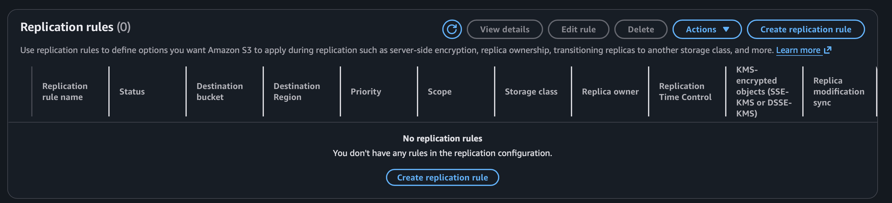
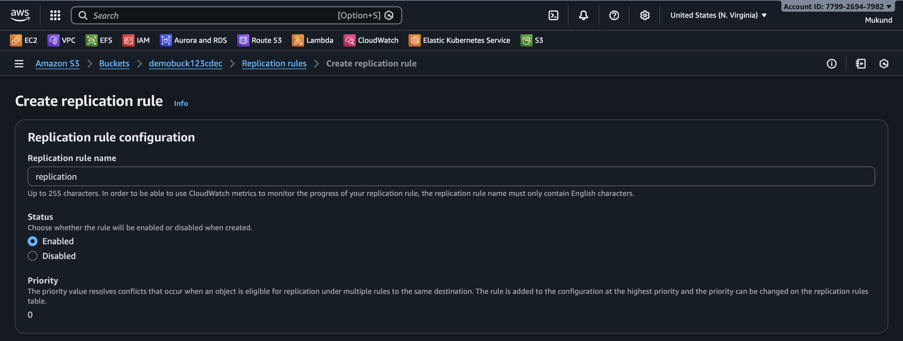
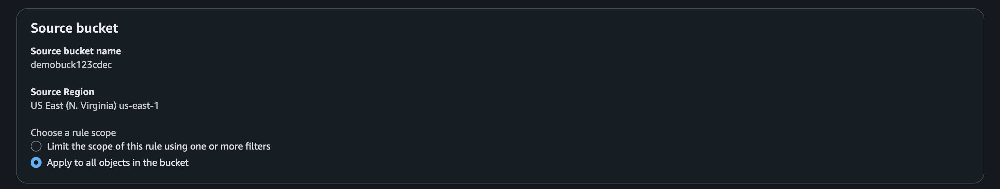
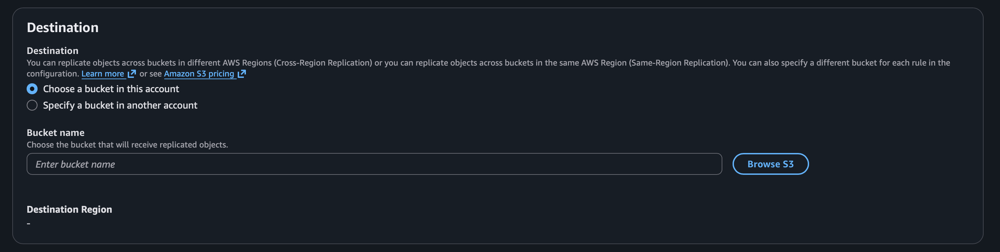
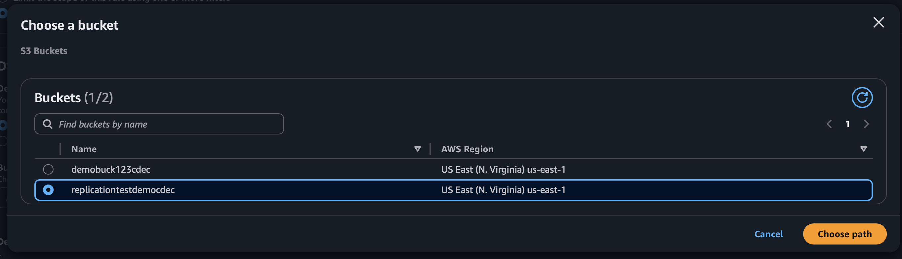
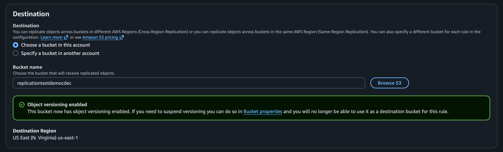
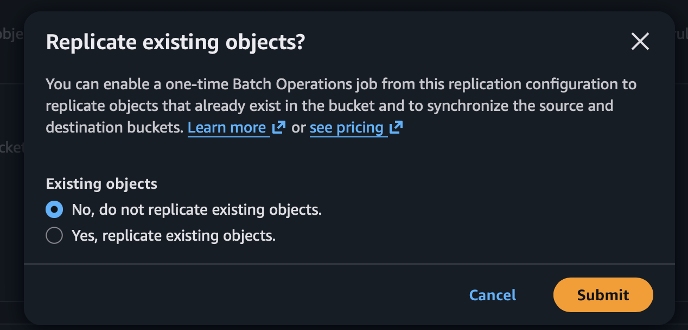
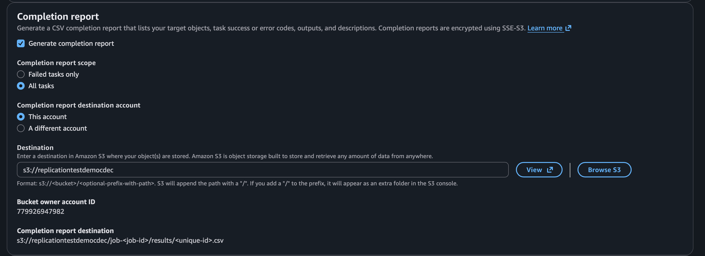
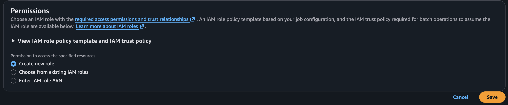

## Introduction to S3 Replication Rule

Amazon S3 Replication Rule is a data replication feature that automatically copies objects from one S3 bucket to another bucket, either in the same AWS Region (SRR – Same-Region Replication) or in a different AWS Region (CRR – Cross-Region Replication).

Replication rules help in maintaining data durability, disaster recovery, compliance requirements, and low-latency access for users located in different geographic locations. Once replication is enabled, all new objects uploaded to the source bucket are automatically replicated to the destination bucket without manual intervention.

S3 Replication supports filtering objects using prefixes and tags, replicating existing objects, and maintaining object metadata, permissions, and encryption settings. This ensures that replicated data remains consistent, secure, and available across multiple locations.

Replication rules are widely used for backup storage, business continuity planning, regulatory compliance, and global content distribution.

# Steps to Configure S3 Replication Rule

### Step 1: Enable Versioning on Both Buckets
Open **Amazon S3** and enable **Versioning** on:
- Source bucket
- Destination bucket

### Step 2: Open Source Bucket
Go to the **source bucket** from which objects will be replicated.

### Step 3: Open Management Tab
Navigate to the **Management** tab of the source bucket.

### Step 4: Open Replication Rules
Scroll to **Replication rules** and click **Create replication rule**.

### Step 5: Enter Rule Name
Provide a name for the replication rule.

### Step 6: Choose Rule Scope
Select:

### step 7: chose destination bucket 

### step 8: create job to replication 

### chose destination bucket to store report in buccket 

### create replication role 

