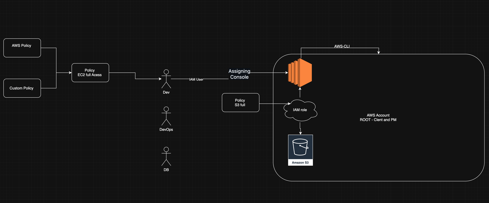

## IAM : Identity Acess management
- https://docs.aws.amazon.com/IAM/latest/UserGuide/introduction.html
- Introduction to IAM Services
  
### iam User 
- An IAM user is an entity that you create in your AWS account. The IAM user represents the human user or workload who uses the IAM user to interact with AWS resources. An IAM user consists of a name and credentials.
- https://docs.aws.amazon.com/IAM/latest/UserGuide/id_users.html

### iam Group 
- An IAM user group is a collection of IAM users. User groups let you specify permissions for multiple users, which can make it easier to manage the permissions for those users.
- https://docs.aws.amazon.com/IAM/latest/UserGuide/id_groups.html

### iam Role 
- An IAM role is an IAM identity that you can create in your account that has specific permissions. An IAM role is similar to an IAM user, in that it is an AWS identity with permission policies that determine what the identity can and cannot do in AWS
- https://docs.aws.amazon.com/IAM/latest/UserGuide/id_roles.html

### Iam Policy 
- Manage access in AWS by creating policies and attaching them to IAM identities (users, groups of users, or roles) or AWS resources. A policy is an object in AWS that, when associated with an identity or resource, defines their permissions.
- https://docs.aws.amazon.com/IAM/latest/UserGuide/access_policies.html

- Practical Demo: policy Implementation and Restriction Tests
- Creating IAM Users
`Demo ---> Aws IAM user creation`

- Assigning Console and Programmatic access
`Consol acess : - IAM credentials`
`Programmatic access : - Acess key & secrets key`

aws cli 
- https://docs.aws.amazon.com/cli/v1/userguide/install-linux.html

- Group creation and policy Attachment
`DEMO : -- IAM greoup creating add user and assing permission to group `
