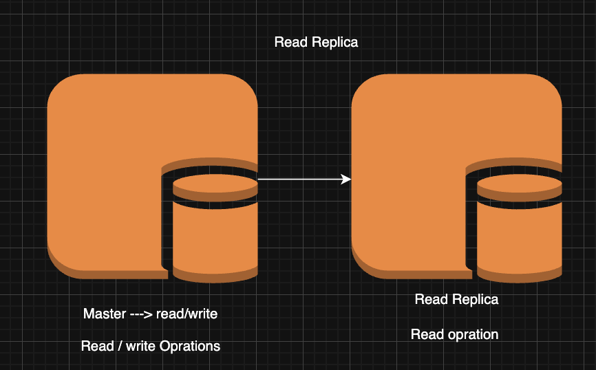
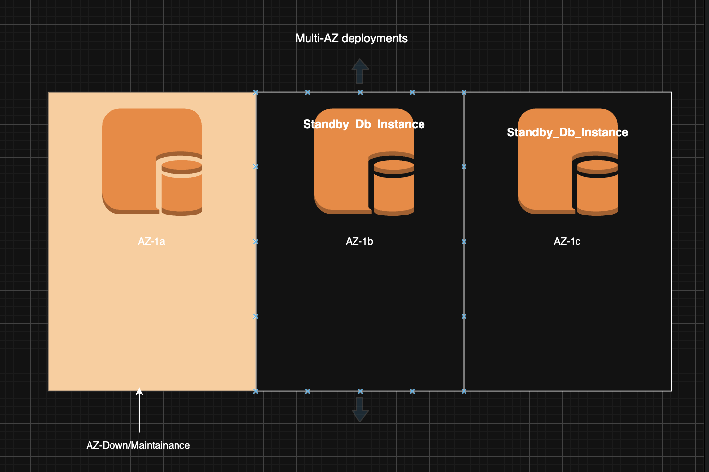

## RDS database 
https://docs.aws.amazon.com/AmazonRDS/latest/UserGuide/USER_ReadRepl.html
- amazon manage database service
- relational database service
- supports multiple database engines like MySQL, PostgreSQL, Oracle, SQL Server, and MariaDB
- provides high availability, scalability, and security
- automated backups, snapshots, and replication


## read replica 
- a read-only copy of the primary database
- used to offload read traffic from the primary database
- can be in the same region or in a different region
- can be promoted to a standalone database instance


## Multi-AZ deployments
- provides high availability and failover support
- automatically replicates data to a standby instance in a different availability zone
- in case of a failure, the standby instance is automatically promoted to primary
- minimizes downtime and data loss


```
what is Read Replica ?
What is Multi-AZ Deployment ?
diff between Read Replica vs Multi-AZ deployment ? 
```
---
