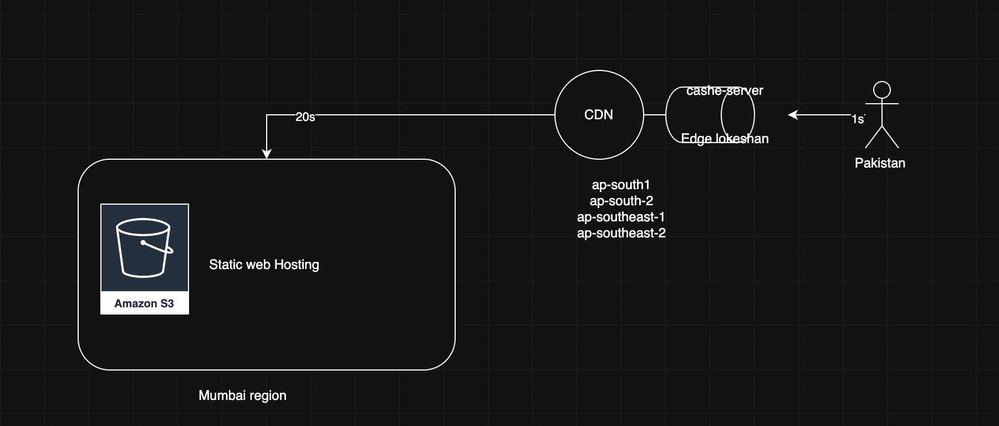

## CDN
cdn - Content Delivery Network---> cloudfront 


steps to setup a CDN using AWS CloudFront:
1. Create an S3 bucket and upload your static website files.
2. Go to the CloudFront console and create a new distribution.
3. Select your S3 bucket as the origin.
4. Configure cache settings, SSL, and other options as needed.
5. Deploy the distribution and update your DNS records to point to the CloudFront URL.


## Benefits of using CDN
1. Improved website performance by reducing latency.
2. Scalability to handle high traffic loads.
3. Global reach with edge locations worldwide.




---


# 🌐  Content Delivery with CloudFront 🌐 

## Introduction to CloudFront
AWS CloudFront is a global content delivery network (CDN) service that securely delivers data, videos, applications, and APIs to users with low latency and high transfer speeds. It works by caching content at edge locations worldwide.

### Benefits of CloudFront:
- **Reduced Latency**: Serves content from the nearest edge location to the user.
- **Improved Security**: Integrates with AWS Shield, AWS WAF, and HTTPS encryption.
- **Cost Optimization**: Reduces data transfer costs with caching mechanisms.
- **Scalability**: Handles traffic spikes efficiently without additional infrastructure.

---

##   CloudFront + S3 Integration to Host Frontend of Website

### Step 1: Create an S3 Bucket
1. Navigate to the **AWS S3 Console**.
2. Click **Create bucket**.
3. Enter a **unique bucket name**.
4. Choose **Region**.
5. **Disable Block Public Access** (for public website hosting).
6. Click **Create bucket**.

### Step 2: Upload Website Files
1. Open the created bucket.
2. Click **Upload**.
3. Select your website frontend files (HTML, CSS, JS, images).
4. Click **Upload**.

### Step 3: Enable Static Website Hosting
1. Open your **S3 Bucket**.
2. Go to **Properties**.
3. Scroll down to **Static website hosting**.
4. Select **Enable**.
5. Set the **index document** (e.g., `index.html`).
6. Click **Save changes**.

### Step 4: Create a CloudFront Distribution
1. Navigate to the **AWS CloudFront Console**.
2. Click **Create Distribution**.
3. Select **Web** as delivery method.
4. Under **Origin Settings**:
   - **Origin Domain Name**: Choose the S3 bucket.
   - **Origin Access Control (OAC)**: Enable OAC for security.
   - **Restrict Bucket Access**: Yes.
5. Set **Default Cache Behavior**:
   - Viewer Protocol Policy: Redirect HTTP to HTTPS.
   - Allowed HTTP Methods: GET, HEAD, OPTIONS.
6. Click **Create Distribution**.

### Step 5: Update S3 Bucket Policy
1. Open the S3 bucket.
2. Go to **Permissions** → **Bucket Policy**.
3. Add the following policy to allow CloudFront to access S3:
   ```json
   {
     "Version": "2012-10-17",
     "Statement": [
       {
         "Effect": "Allow",
         "Principal": {
           "Service": "cloudfront.amazonaws.com"
         },
         "Action": "s3:GetObject",
         "Resource": "arn:aws:s3:::your-bucket-name/*"
       }
     ]
   }
   ```
4. Replace `your-bucket-name` with your actual bucket name.
5. Click **Save**.

### Step 6: Access Your Website via CloudFront
- Copy the **CloudFront Domain Name** from the AWS CloudFront console.
- Open a browser and enter the CloudFront URL.
- Your website is now delivered via CloudFront globally! 🚀

---

## Best Practices
- **Enable Logging**: Use CloudFront access logs for monitoring.
- **Use SSL/TLS**: Secure your website using HTTPS with an SSL certificate.
- **Cache Optimization**: Configure cache policies for efficient content delivery.
- **Restrict Direct S3 Access**: Ensure users access content only via CloudFront.
