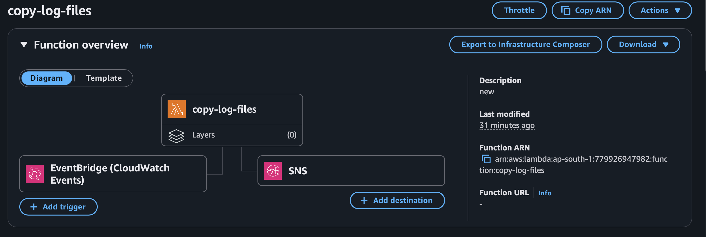
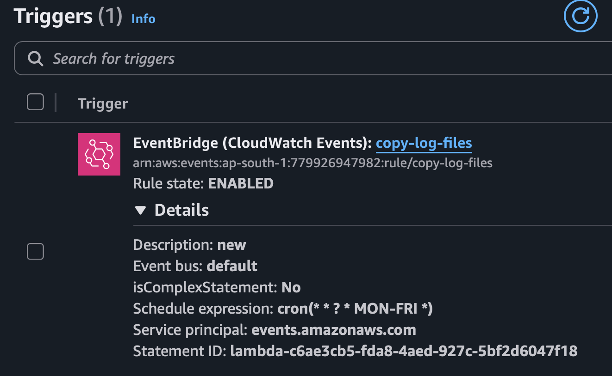
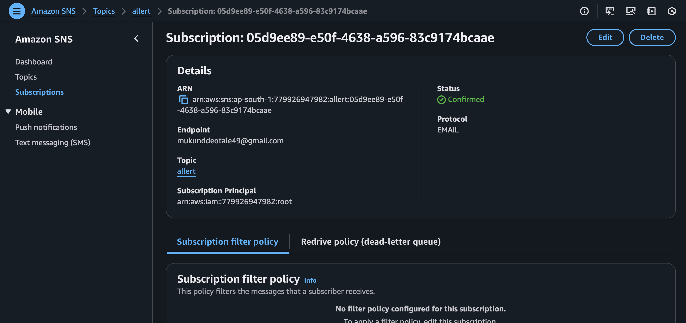

## Lambda
- AWS offers technologies for running code, managing data, and integrating applications, all without managing servers.

### crete buccket
```py
import boto3
from botocore.exceptions import ClientError

def lambda_handler(event, context):
    bucket_name = 'uniq_buccket_name'
    region = 'us-east-1' # Change to your preferred region
    
    s3_client = boto3.client('s3')
    
    try:
        # Check if bucket exists
        s3_client.head_bucket(Bucket=bucket_name)
        message = f"Bucket '{bucket_name}' already exists and is owned by you."
    except ClientError as e:
        error_code = e.response['Error']['Code']
        if error_code == '404':
            # Bucket does not exist, create it
            if region == 'us-east-1':
                s3_client.create_bucket(Bucket=bucket_name)
            else:
                s3_client.create_bucket(
                    Bucket=bucket_name,
                    CreateBucketConfiguration={'LocationConstraint': region}
                )
            message = f"Bucket '{bucket_name}' created successfully."
        else:
            message = f"Error checking bucket: {str(e)}"

    return {
        'statusCode': 200,
        'body': message
    }
```
## Copy Log files 
- ec2 instance ; lambda function must be in the same region
- ec2 instance has role with acess of s3 : ssm 
- lambda function must be have role of s3 ; ec2

```py

import boto3
import time

def wait_for_ssm(instance_id):
    ssm = boto3.client('ssm')
    while True:
        resp = ssm.describe_instance_information()
        ids = [i['InstanceId'] for i in resp['InstanceInformationList']]
        if instance_id in ids:
            print("SSM Online")
            break
        print("Waiting for SSM...")
        time.sleep(15)

def lambda_handler(event, context):

    ssm = boto3.client('ssm')

    instance_id = 'i-015a705f75e5391f3'
    bucket_name = 'baltitestforlambdafunction'
    log_path = "/home/ubuntu/"

    wait_for_ssm(instance_id)

    command = f"aws s3 sync {log_path} s3://{bucket_name}/ec2-logs/{instance_id}/"

    response = ssm.send_command(
        InstanceIds=[instance_id],
        DocumentName="AWS-RunShellScript",
        Parameters={'commands': [command]}
    )

    return {
        'statusCode': 200,
        'body': response['Command']['CommandId']
    }

```
install ssm-agent 
```
snap install amazon-ssm-agent --classic
systemctl enable snap.amazon-ssm-agent.amazon-ssm-agent.service
systemctl start snap.amazon-ssm-agent.amazon-ssm-agent.service

```



### Event bridge trigger 



### sns


