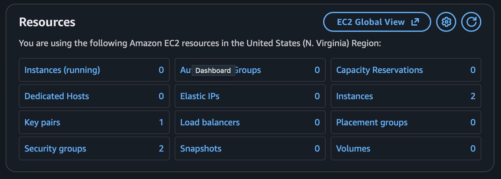
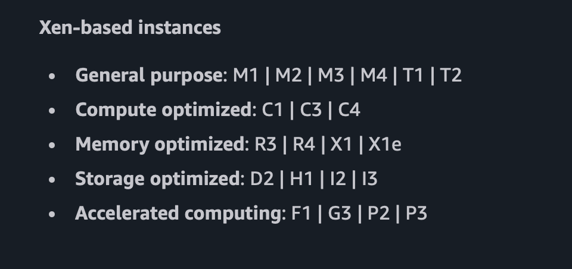
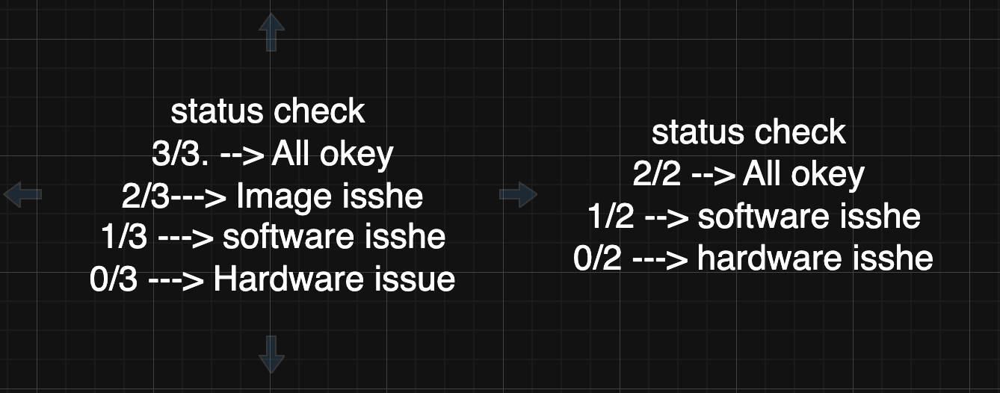

## 
- Explain complete Dashboard of EC2
- Instance Types (https://docs.aws.amazon.com/AWSEC2/latest/UserGuide/instance-types.html)
- instance state (https://docs.aws.amazon.com/AWSEC2/latest/UserGuide/ec2-instance-lifecycle.html) 

- Explain complete Dashboard of EC2  

- Instance Types
- https://docs.aws.amazon.com/AWSEC2/latest/UserGuide/instance-types.html
  

- Status check, AMI (Types, Create, and copy)

- Launch Template, Purchasing Options
- https://docs.aws.amazon.com/AWSEC2/latest/UserGuide/create-launch-template.html (lanch template)
- https://docs.aws.amazon.com/AWSEC2/latest/UserGuide/instance-purchasing-options.html (purchesing Option)
---

## **Instance Types**

Amazon EC2 offers a wide range of instance types to suit diverse workloads. Below are the main categories:

### **General Purpose**
Balanced compute, memory, and storage.
- Examples: M5, T2, T3, M6a, Mac2

### **Compute Optimized**
Ideal for compute-intensive tasks.
- Examples: C5, C6i, C7g

### **Memory Optimized**
Designed for high-performance databases and memory-intensive applications.
- Examples: R5, X1, X2idn

### **Storage Optimized**
For workloads requiring high, sequential read/write access to large data sets.
- Examples: I3, D2, H1

### **Accelerated Computing**
Designed for applications requiring GPUs or hardware accelerators.
- Examples: P3, G5, Inf1

### **High-Performance Computing (HPC)**
For HPC applications requiring low latency and high performance.
- Examples: Hpc6a, Hpc7g

[Refer to AWS Instance Types Documentation](https://aws.amazon.com/ec2/instance-types/)

