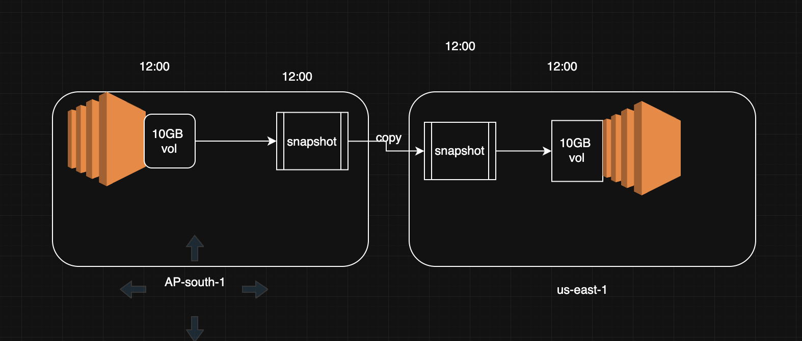
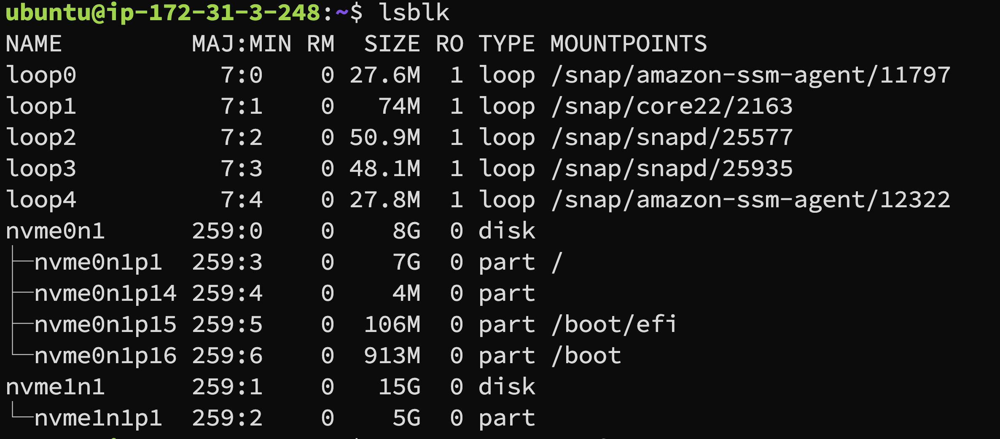
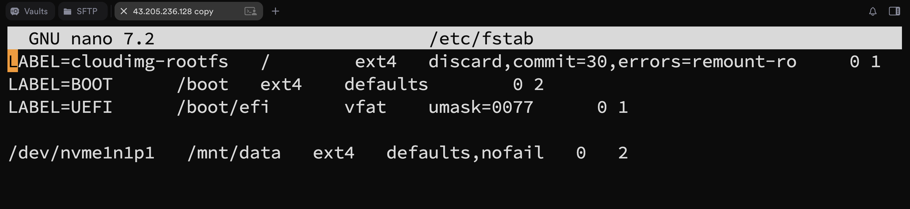
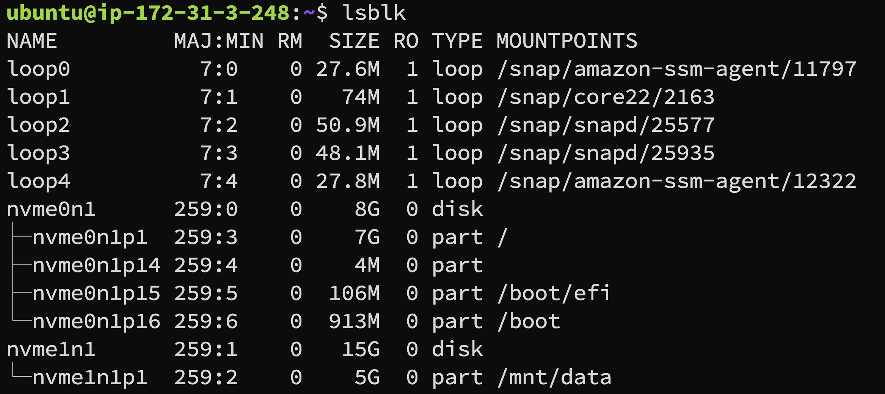

## Snapshot 
- https://docs.aws.amazon.com/ebs/latest/userguide/ebs-snapshots.html
- https://aws.amazon.com/ebs/snapshots/




## permenant mounting 
```
lsblk ## to check volume is attached or not
fdisk /dev/nvme1n1
  n
  p
  +5G
  w
mkdir /data
mkfs.ext4 /dev/nvme1n1p1  ## attached file system 
lsbk
blkid  /dev/nvme1n1p1 ## label
nano /etc/fstab ## entry uuid /data
mount -a
systemctl daemon-reload
```

## file system and mounting 
https://www.redhat.com/en/blog/partitions-fdisk

## volume mounting and partation 
- lsblk -- list storage
- fdisk /dev/<storage>


# temporary and permenant mounting 
for temporary mounting use
- mount /dev/xvdf1 /mnt/ebs

# Permenant mounting 
# EBS Volume Mounting Procedure 

## **Attach Volumes, Create Partition, and Mount**

### **Attaching an EBS Volume to an EC2 Instance**
1. Go to the **EC2 Dashboard** on the AWS Management Console.
2. Select **Volumes** from the left menu.
3. Choose the volume you want to attach and click **Actions > Attach Volume**.
4. Select the instance to attach the volume to and click **Attach**.

### **Creating a Partition**
1. SSH into the EC2 instance to which the volume was attached.
2. Use the `lsblk` command to list all block devices and confirm the new volume is attached (e.g., `/dev/xvdf`).
3. Create a partition on the volume using the `fdisk` command:
   ```bash
   sudo fdisk /dev/nvme1n1
   ```
   - Press `n` to create a new partition.
   - Follow the prompts and press `w` to write changes.
4. Format the partition:
   ```bash
   sudo mkfs.ext4 /dev/nvme1n1p1
   ```

### **Mounting the Volume**
1. Create a mount directory:
   ```bash
   sudo mkdir /mnt/data
   ```
2. Mount the volume:
   ```bash
   sudo mount /dev/nvme1n1p1 /mnt/data
   ```
3. Verify the volume is mounted:
   ```bash
   df -h
   ```

---

### **Persisting the Mount (Optional)**


To make the mount persistent across reboots:
1. Open the `/etc/fstab` file:
   ```bash
   sudo nano /etc/fstab
   ```
2. Add the following entry:

   ```bash
   /dev/nvme1n1p1   /mnt/data   ext4   defaults,nofail   0   2
   ```
  

3. Save the file and exit.
4. Test the configuration:
   ```bash
   sudo mount -a
   ```


---

## **Summary**

- **EBS Volumes**: Provide persistent, reliable block storage.
- **Volume Types**: Include SSDs (gp3, gp2, io1, io2), HDDs (st1, sc1), and magnetic storage.
- **Operations**: Attach a volume, create partitions, format, and mount it to an EC2 instance.

```
5th field
0 -  exclude file system backup 
1 -  backup fs everyday 
2 - backup the file system every other day 

6th field 
fs chek for errors during boot process 
0 - exclude fs from fscheck 
1 - check fs during first fscheck 
2 - check fs during second pass of fscheck 
 used for non root fs 

```


----
