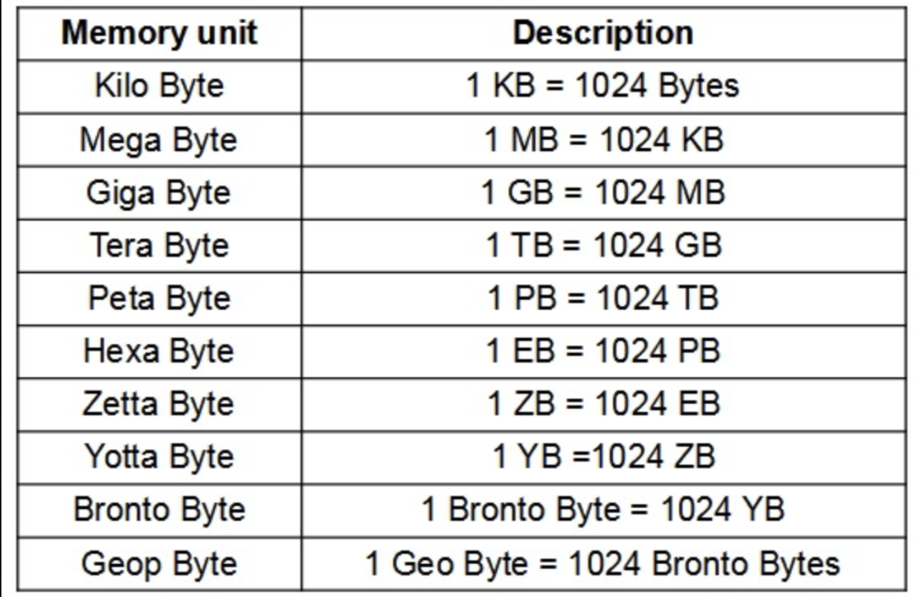
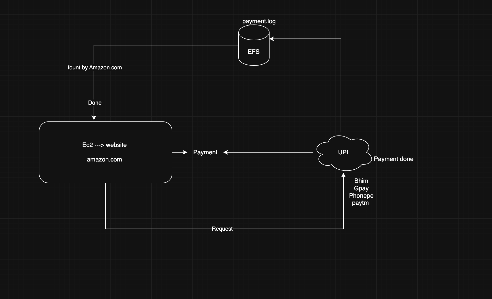

## Aws storage types 
- Block Storage --> EBS (Elastic Block Store)
- Object Storage --> S3 (Simple Storage Service)
- Network File System --> EFS (Elastic File System) (shared storage)
- https://docs.aws.amazon.com/efs/latest/ug/whatisefs.html
## NFS 
- https://docs.aws.amazon.com/filegateway/latest/files3/create-nfs-file-share.html
- Network File System
- Used to share files between multiple instances
- EFS is a managed NFS service provided by AWS

## Ec2 mounting steps EFS 
1. Create an EFS file system in the same VPC as your EC2 instances.
2. Create mount targets in each availability zone where your EC2 instances are located.
3. Ensure that the security group associated with your EFS allows inbound traffic on port 2049 (NFS).
4. Install the NFS client on your EC2 instances (if not already installed).
   - For ubuntu: `sudo apt-get install nfs-common -y`

5. Create a directory on your EC2 instance to serve as the mount point for the EFS file system.
   - `sudo mkdir /mnt/efs`  
6. Mount the EFS file system to the directory you created using the following command:
   go to EFS console --> select your EFS --> click on "attach" --> copy the mount command for IP based mount or DNS based mount
    - Example command: `sudo mount -t nfs4 -o nfsvers=4.1 fs-12345678.efs.us-west-2.amazonaws.com:/ /mnt/efs`
7. Verify that the EFS file system is mounted by running the `df -h` command and checking for the EFS mount point.
8. (Optional) To ensure that the EFS file system is mounted automatically on system reboot, add an entry to the `/etc/fstab` file:
   - Open the fstab file: `sudo nano /etc/fstab`
   - Add the following line at the end of the file:
     ```
     fs-12345678.efs.us-west-2.amazonaws.com:/ /mnt/efs nfs4 defaults,_netdev 0 0
     ```
   - Save and exit the file.    

   mount via DNS based mount steps
   - Go to the EFS console.
   - Select your EFS file system.
   - Click on "Attach".
   - Copy the mount command for DNS-based mount.
   - Example command: `sudo mount -t nfs4 -o nfsvers=4.1 fs-12345678.efs.us-west-2.amazonaws.com:/ /mnt/efs`
   - sg rules should allow inbound traffic on port 2049 (NFS) from your EC2 instances.
 



