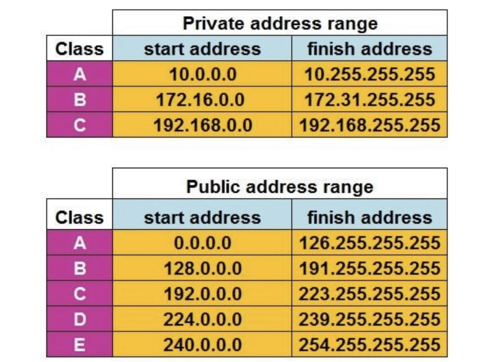
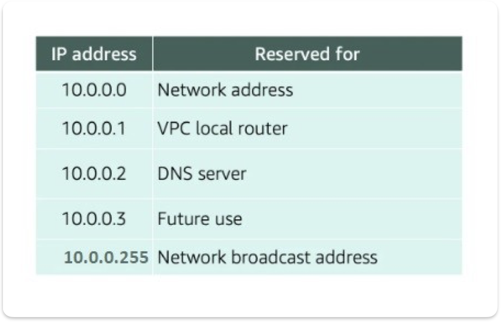
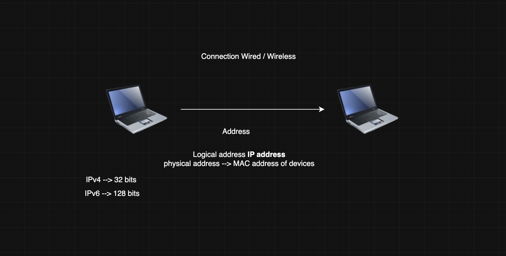

## Networking 
## vpc 
With Amazon Virtual Private Cloud (Amazon VPC), you can launch AWS resources in a logically isolated virtual network that you've defined.
- https://docs.aws.amazon.com/vpc/latest/userguide/what-is-amazon-vpc.html

## private IP ranges 
```
IPv4 Private IP Ranges (RFC 1918) 
Class A: 10.0.0.0 to 10.255.255.255 (CIDR: 10.0.0.0/8)
Class B: 172.16.0.0 to 172.31.255.255 (CIDR: 172.16.0.0/12)
Class C: 192.168.0.0 to 192.168.255.255 (CIDR: 192.168.0.0/16)
```


## vpc - 192.168.0.0/16
- sub1 - 192.168.0.0/21
- sub2 - 192.168.8.0/21 



```
10.0.0.0: Network address.
10.0.0.1: Reserved by AWS for the VPC router.
10.0.0.2: Reserved by AWS. The IP address of the DNS server is the base of the VPC network range plus two. For VPCs with multiple CIDR blocks, the IP address of the DNS server is located in the primary CIDR. We also reserve the base of each subnet range plus two for all CIDR blocks in the VPC. For more information, see Amazon DNS server.
10.0.0.3: Reserved by AWS for future use.
10.0.0.255: Network broadcast address. We do not support broadcast in a VPC, therefore we reserve this address.
```

----


## what is networking 
- connection between two devices through wired or wireless

## classfull 
```
Classes of IP's 
- Class A    | 0-126 (127--> loop back address / Localhost ) | N.H.H.H 
- Class B    | 128-191                                       | N.N.H.H 
- Class C    | 192-223                                       | N.N.N.H
- Class D    | 224-239  ---> SCIENTIFIC USE / EXPERIMENTAL USE 
- Class E    | 240-255 ---> FEACTURE USE 
```

## Classless
CIDR --> classless interdomain Routing

---

# Basics of Networking

Networking is the backbone of modern computing and communication systems. It involves connecting devices to share resources, data, and information efficiently. Key components and concepts of networking include:

## Key Networking Components:
1. **IP Address (Internet Protocol Address):** A unique identifier assigned to each device on a network. It can be IPv4 (e.g., 192.168.1.1) or IPv6 (e.g., 2001:0db8:85a3:0000:0000:8a2e:0370:7334).

2. **Subnet Mask:** Defines the network and host portions of an IP address. For example, in IPv4, a subnet mask of 255.255.255.0 allows 256 total addresses, of which one is for the network and one for broadcast.

3. **Gateway:** A node that routes traffic from one network to another, typically connecting a private network to the internet.

4. **DNS (Domain Name System):** Translates human-readable domain names (e.g., www.example.com) into IP addresses.

5. **MAC Address (Media Access Control):** A hardware address that identifies devices within a local network.

## Types of Networks:
- **LAN (Local Area Network):** Small networks, typically within a single location, such as a home or office.
- **MAN (Metropolitan Area Network):** Covers a city or large area, larger than LAN but smaller than WAN.
- **WAN (Wide Area Network):** Large networks spanning geographic locations, such as the internet.
- **VLAN (Virtual Local Area Network):** Logical segmentation of a LAN for better management and security.

## Networking Protocols:
1. **TCP/IP (Transmission Control Protocol/Internet Protocol):** Core protocol suite for communication over the internet.
2. **HTTP/HTTPS:** Protocols for transferring hypertext data (webpages).
3. **FTP (File Transfer Protocol):** For transferring files over a network.
4. **SSH (Secure Shell):** For secure remote administration.

---

# CIDR (Classless Inter-Domain Routing)

## What is CIDR?
Classless Inter-Domain Routing (CIDR) is a method for efficiently allocating IP addresses and routing data. It replaces the older class-based IP addressing system (Class A, B, and C).
