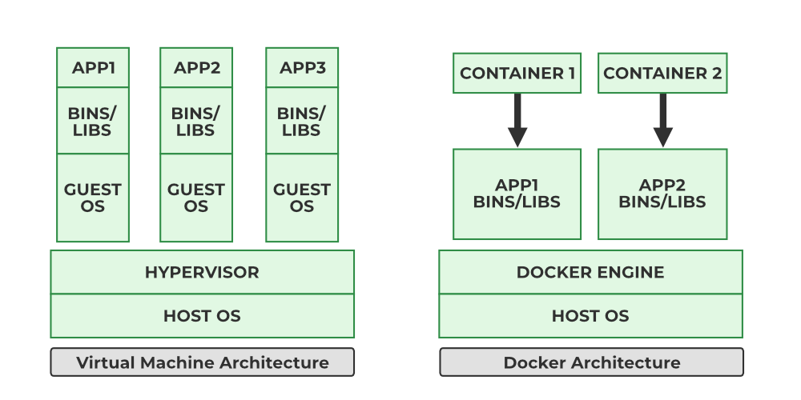

# Day 1 – Docker Fundamentals

## Monolithic vs Microservices

### Monolithic Architecture
- Single, large codebase and deployable unit (e.g., one app/JAR/WAR).
- All features tightly coupled and share the same resources.
- **Pros**: simple to start, easier initial development, single deployment.
- **Cons**: hard to scale specific parts, slower deployments, tech lock-in, one bug can impact entire app.

### Microservices Architecture
- Application split into many small, independent services.
- Each service has its own codebase, deployment pipeline, and often its own database.
- **Pros**: independent scaling and deployment, better fault isolation, tech diversity per service.
- **Cons**: more operational complexity (networking, monitoring, logging, distributed tracing).

---

## Traditional vs Virtualization vs Containerization Deployment

### Traditional Deployment
- App + dependencies installed directly on the host OS.
- Multiple apps may share the same libraries and runtimes.
- **Issues**:
  - Dependency conflicts.
  - "Works on my machine" problems.
  - Difficult to isolate and scale applications.

### Virtualization (VMs)
- Uses a **hypervisor** (e.g., VMware, Hyper-V) to run multiple virtual machines.
- Each VM has its own **guest OS**, libraries, and apps.
- **Pros**:
  - Strong isolation between VMs.
  - Can run different OSs on the same hardware.
- **Cons**:
  - Heavy: each VM includes a full OS.
  - Slower boot times.
  - Lower density (fewer VMs per host compared to containers).

### Containerization
- Containers share the **host OS kernel** but isolate processes, filesystem, and networking.
- **Image**: read-only template for creating containers.
- **Container**: running instance of an image.
- **Pros**:
  - Lightweight and start in seconds.
  - High density (many containers per host).
  - Consistent environments from dev to prod.

---

## Introduction to Containerization, Container, Image

- **Containerization**: Packaging an application with its dependencies into a standard unit (image) and running it as an isolated process (container).
- **Image**:
  - Immutable filesystem snapshot + metadata (env vars, default command, etc.).
  - Built from a Dockerfile or created from existing containers.
- **Container**:
  - A running (or stopped) instance of an image.
  - Has its own filesystem, process space, network interfaces.
  - Designed to be disposable and replaceable.

Key principles:
- Build once, run anywhere (where Docker is available).
- Treat containers as ephemeral; persist state using volumes and external services.

---

## Introduction to Docker

- Docker is a platform to **build, ship, and run** containerized applications.
- Main components:
  - **Docker Engine** (daemon): background service that manages images, containers, networks, volumes.
  - **Docker CLI** (`docker`): command-line client that talks to the daemon.
  - **Registries** (e.g., Docker Hub, ECR): store and distribute images.

Common workflows:
1. Build image from Dockerfile.
2. Run container from image.
3. Push/pull images to/from a registry.

---

## Docker CE vs Docker EE

- **Docker CE (Community Edition)**
  - Free and open source.
  - Focused on individual developers and small teams.
  - Provides core Docker features.

- **Docker EE (Enterprise Edition)**
  - Commercial, subscription-based.
  - Adds enterprise features (advanced security, certifications, policy and access control, official support).
  - Targeted at large organizations with production and compliance needs.

Conceptually, both run containers; EE adds enterprise tooling and support.

---

## Installing Docker Engine (High-Level Overview)

### Linux (Typical Flow)
- Remove older Docker packages if present.
- Add Docker’s official repository (e.g., using `apt` or `yum`).
- Install packages such as:
  - `docker-ce`
  - `docker-ce-cli`
  - `containerd.io`
- Start and enable the Docker service.
- Optionally add your user to the `docker` group to run Docker without `sudo`.

### macOS / Windows
- Install **Docker Desktop**, which includes:
  - Docker Engine
  - Docker CLI
  - Docker Compose
  - GUI for managing containers and images.

Focus now: understand **what** is being installed (engine + CLI + supporting tools), not the exact commands.

---

## Run Your First Container
- pull images from docker registory
- `docker pull <images name>` to pull the images replace image name as : nginx, httpd, mysql, ubuntu, ...etc
- `docker run -d -P <imagename/imageID>` to run the container from specific image
- `docker ps` to check all the running container
- `docker images` to check all the images

- `docker pull mukunddeo9325/super-mario` <-- pull image from heare 

----

