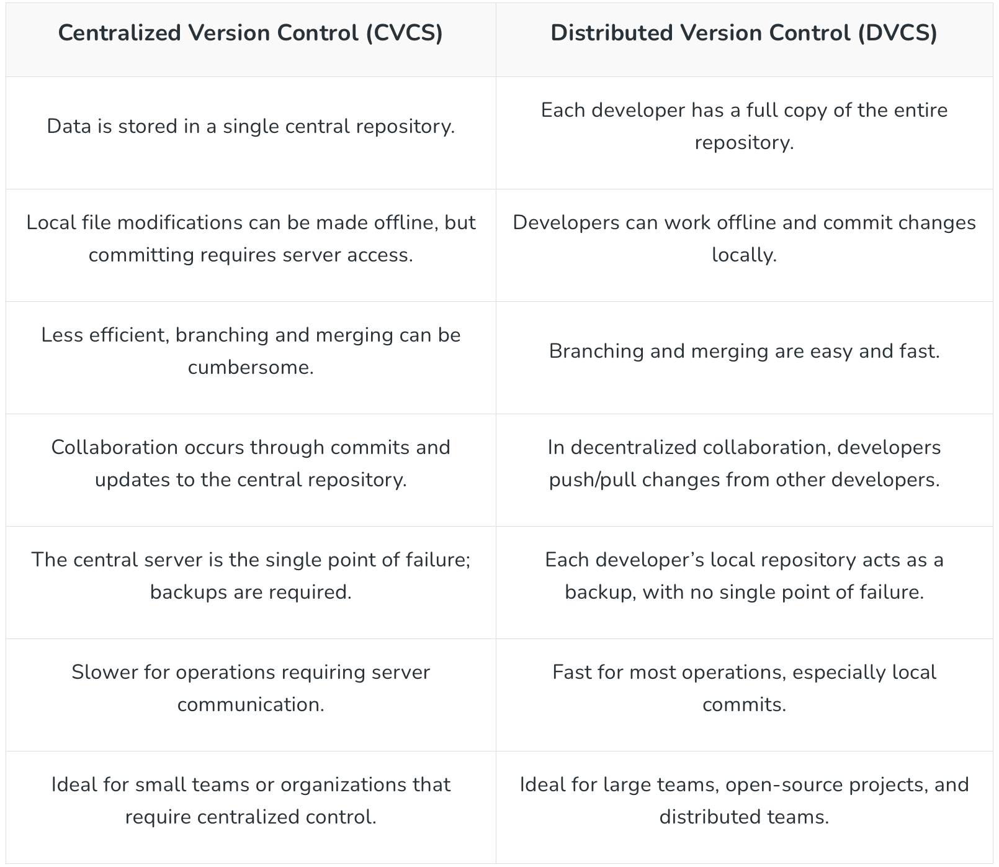
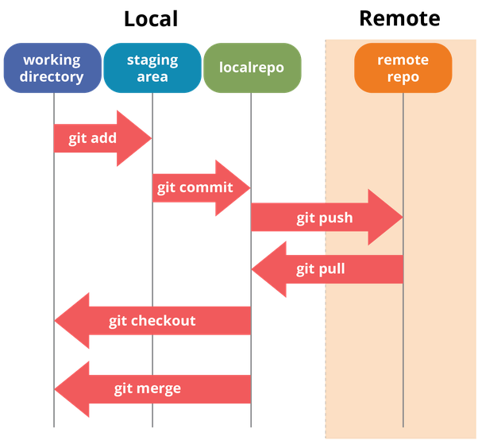
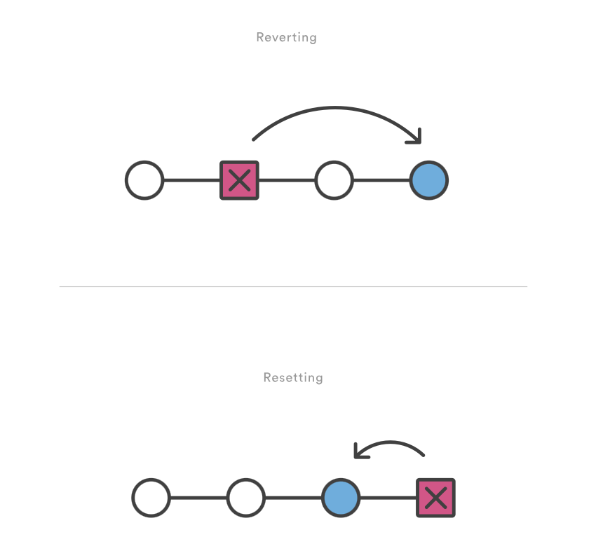

# SCM (Source Code Management) 

## What is SCM?
- SCM (Source Code Management) is the practice of tracking and managing changes to software code. 
- It helps developers collaborate, maintain code versions, and ensure consistency across a project.

## Difference Between Centralized VCS and Distributed VCS
- https://www.geeksforgeeks.org/git/centralized-vs-distributed-version-control-which-one-should-we-choose/


| Feature              | Centralized VCS (CVCS) | Distributed VCS (DVCS) |
|---------------------|---------------------|---------------------|
| Repository         | Single central repository | Multiple repositories (local + remote) |
| Example Tools     | SVN, Perforce        | Git, Mercurial      |
| Offline Work      | Not possible        | Possible (local commits) |
| Speed            | Slower (relies on central server) | Faster (local operations) |
| Collaboration     | Requires network access | Can work offline and push later |



# Introduction to Git
Git is a **Distributed Version Control System (DVCS)** that enables efficient tracking of changes, branching, and collaboration among developers.

## Git Lifecycle
1. **Working Directory**: The local project files.
2. **Staging Area (Index)**: Files marked for the next commit.
3. **Local Repository**: Commits stored in the local `.git` folder.
4. **Remote Repository**: GitHub/GitLab/Bitbucket where the code is shared.

```
Working Directory → Staging Area → Local Repository → Remote Repository
```


# Installing Git CLI
### Windows:
1. Download Git from [git-scm.com](https://git-scm.com/downloads)
2. Install with default settings
3. Verify installation:
   ```sh
   git --version
   ```

### Linux:
```sh
sudo apt update
sudo apt install git -y
git --version
```

### Mac:
```sh
brew install git
git --version
```

# Git Commands (Working on Local Repo)

### Initialize a New Git Repository
```sh
git init
```
This command creates a new Git repository in the current directory.

### Check the Status of Files
```sh
git status
```
Shows modified and untracked files.

### Add Files to the Staging Area
```sh
git add <filename>
```
To add all files:
```sh
git add .
```
### commit and add 
```
git commit -a -m "update"

```
### Commit Changes
```sh
git commit -m "Initial commit"
```
Commits the changes in the staging area with a message.

### View Commit History
```sh
git log
```
Displays the commit history.

### Revert Changes (Undo a Commit)
```sh
git revert <commit-hash>
```
This creates a new commit that undoes changes.

### Restore a File (Undo Local Changes)
```sh
git restore <filename>
```
### Restores the file to the last committed state.

```
The git revert command is a forward-moving undo operation that offers a safe method of undoing changes.
Instead of deleting or orphaning commits in the commit history,
a revert will create a new commit that inverses the changes specified.
Git revert is a safer alternative to git reset in regards to losing work
```



