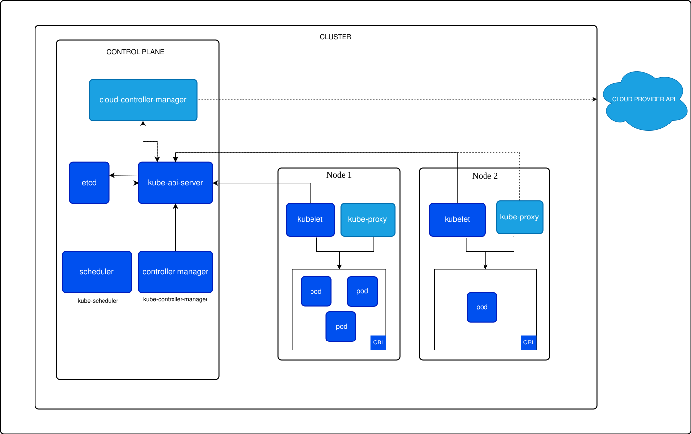
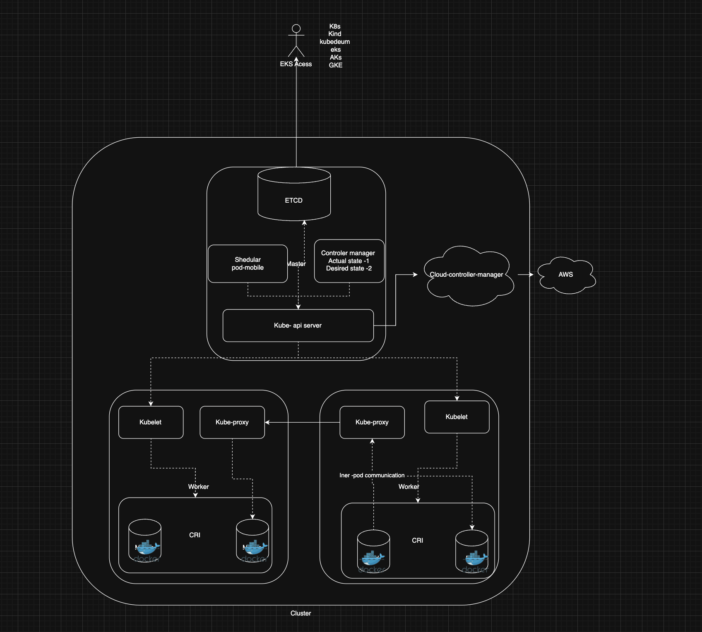

## Introduction to Kubernetes
Kubernetes (often abbreviated as K8s) is an open-source container orchestration platform designed to automate the deployment, scaling, and management of containerized applications.
Initially developed by Google and now maintained by the Cloud Native Computing Foundation (CNCF), Kubernetes has become the industry standard for running containerized workloads at scale.

## Key Features:

- **Automated Scheduling:** Places containers on optimal nodes.
- **Self-Healing:** Restarts failed containers and replaces them automatically.
- **Horizontal Scaling:** Increases or decreases the number of replicas based on load.
- **Service Discovery & Load Balancing:** Exposes containers to the network and balances traffic.
- **Storage Orchestration:** Automatically mounts storage systems.

## Example:
Imagine you have a web application running in 10 containers. Instead of manually starting/stopping them, Kubernetes will:
- Deploy them evenly across multiple servers.
- Replace any crashed containers automatically.
- Route traffic to available containers without downtime.

## Why We Need an Orchestration Tool
When working with a small number of containers, manual management may seem simple. But in production environments with hundreds or thousands of containers, manual management becomes inefficient and error-prone.
Challenges Without Orchestration:

- **Scaling**: Manually starting/stopping containers based on demand.
- **Load Balancing**: Distributing traffic manually.
- **High Availability:** Restarting failed containers quickly.
- **Networking:** Connecting containers securely and consistently.
- **Updates:** Deploying new versions without downtime.

Example Problem:
If you run 100 containers across 5 servers and one server fails, you must:
- Detect the failure.
- Start replacement containers on another server.
- Update your load balancer.
An orchestration tool like Kubernetes does all of this automatically.

## Why Kubernetes?
Kubernetes has emerged as the preferred orchestration tool for several reasons:
1. **Open Source**: Vendor-neutral and community-driven.
2. **Scalability**: Designed to handle large-scale workloads.
3. **Portability**: Works across on-premises, cloud, and hybrid environments.
4. **Extensibility**: Highly customizable through APIs and plugins.
5. **Resilience**: Automatic healing of failed containers and rescheduling.
6. **Comprehensive Ecosystem**: Supported by a wide range of tools and platforms.

## Architecture of kubernetes
- https://kubernetes.io/docs/concepts/architecture/

# 5. Lifecycle of Pods

A **Pod** is the smallest deployable unit in Kubernetes.

Pods go through different lifecycle phases.

## Pod Lifecycle Phases

| Phase | Description |
|------|-------------|
| Pending | Pod is created but containers are not yet running |
| Running | Containers are running successfully |
| Succeeded | Pod completed execution successfully |
| Failed | Pod terminated with an error |
| Unknown | Pod state cannot be determined |

