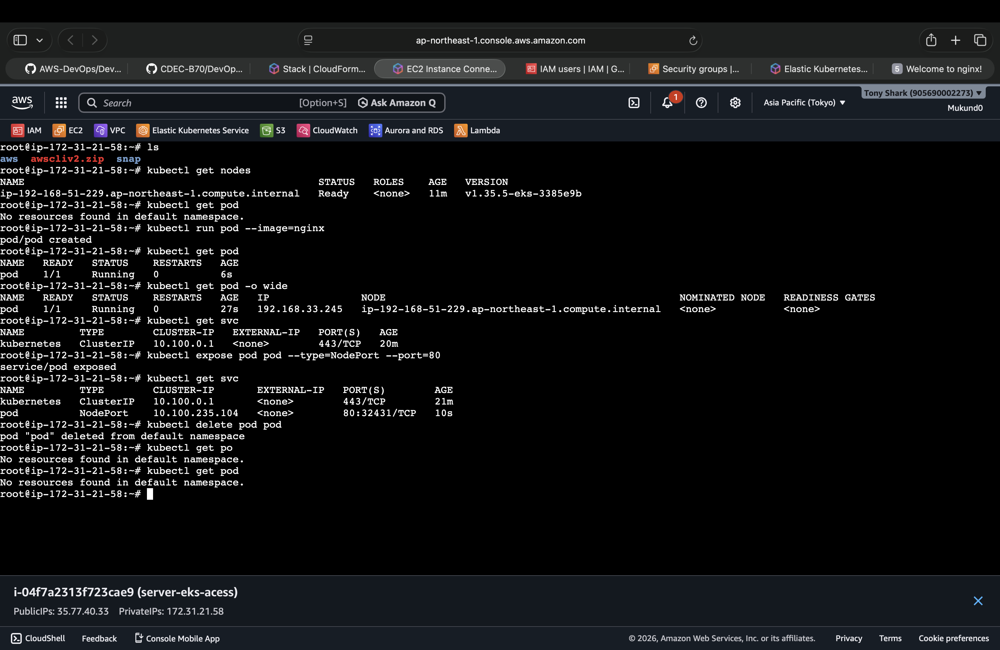

## K8s
## Installation 
commands 
```
kubectl get nodes
```

```
kubectl run nginx-pod --image=nginx
```

- to list pods 
```
kubectl get pods
```
- list in detail `kubectl get pods -o wide` 

- list all the services in the cluster
```
kubectl get svc
```
- To run pod on service (svc)
```
kubectl expose pod nginx-pod --type=NodePort --port=80
```
### to delete pod
```
kubectl delete pod nginx-pod
```
## to check pod is running or not on Node 
```
kubectl exec -it nginx-pod -- curl localhost
```
### to enter in pod 
```
kubectl exec -it nginx-pod -- bash
```



