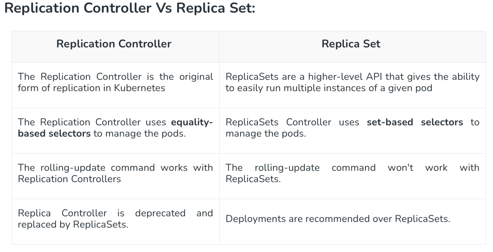

# Introduction to YAML Scripts and Kubernetes Manifest Files

## Understanding YAML Scripts
YAML (YAML Ain't Markup Language) is a human-readable data serialization format used extensively in Kubernetes for writing manifest files. It is used to define resources like Pods, Services, Deployments, and more.

### Key Features of YAML
- **Readable**: YAML is simple and easy to understand.
- **Indentation-Based**: Proper indentation is crucial.
- **Data Types**: Supports scalars (strings, numbers), lists, and dictionaries.

### Example YAML Structure
```yaml
apiVersion: v1
kind: Pod
metadata:
  name: my-pod
  labels:
    app: my-app
spec:
  containers:
    - name: nginx
      image: nginx:latest
      ports:
        - containerPort: 80
```

## Writing Manifest Files for Pods and Services
Kubernetes uses manifest files to describe the desired state of resources in the cluster. These files are written in YAML.

### Pod Manifest File
A Pod is the smallest deployable unit in Kubernetes.

```yaml
apiVersion: v1
kind: Pod
metadata:
  name: my-pod
  labels:
    app: my-app
spec:
  containers:
    - name: nginx
      image: nginx:latest
      ports:
        - containerPort: 80
```
**Explanation**:
- `apiVersion`: The API version used (e.g., v1).
- `kind`: The type of resource (e.g., Pod).
- `metadata`: Metadata such as the name and labels.
- `spec`: Specification of the Pod, including containers and their properties.

### Service Manifest File
Services expose Pods to the network and enable communication between them.

```yaml
apiVersion: v1
kind: Service
metadata:
  name: my-cl-service
spec:
  selector:
    app: my-app
  ports:
    - protocol: TCP
      port: 80
      targetPort: 80
  type: ClusterIP
```
**Explanation**:
- `selector`: Matches the labels of the Pods to be exposed.
- `ports`: Defines the service port and the target port on the Pod.
- `type`: Specifies the service type (e.g., ClusterIP, NodePort)

---
### Kubernetes Service Types for Networking

#### 1. **ClusterIP**
- Default service type.
- Exposes the service only within the cluster.
- Example:
```yaml
apiVersion: v1
kind: Service
metadata:
  name: my-clip-svc
spec:
  selector:
    app: my-app
  ports:
  - protocol: TCP
    port: 80
    targetPort: 80
```

#### 2. **NodePort**
- Exposes the service on a static port on each node.
- Example:
```yaml
apiVersion: v1
kind: Service
metadata:
  name: my-np-svc
spec:
  type: NodePort
  selector:
    app: my-app
  ports:
  - protocol: TCP
    port: 80
    targetPort: 80
    nodePort: 31195
```

#### 3. **LoadBalancer**
- Exposes the service externally using a cloud provider’s load balancer.
- Example:
```yaml
apiVersion: v1
kind: Service
metadata:
  name: my-lb-service
spec:
  type: LoadBalancer
  selector:
    app: my-app
  ports:
  - protocol: TCP
    port: 80
    targetPort: 80
```


```yaml 
apiVersion: v1
kind: Namespace
metadata:
  name: test
---
````
```bash 
kubectl apply -f namespace.yaml
```
```yaml
apiVersion: v1
kind: Service
metadata: 
  name: nodeportsrv
spec:
  type: NodePort  #LoadBalancer #ClusterIp
  selector: 
    app: new-app
  ports:
    - port: 80
      targetPort: 80
      name: nginx
      protocol: TCP
    - port: 8080
      targetPort: 8080
      name: tomcat
      protocol: TCP
```
```bash
kubectl apply -f service.yaml
```
pod.yaml
```yaml
apiVersion: v1
kind: Pod
metadata:
  name: test-pod
  namespace: test
  labels:
    app: test-app
spec:
  containers:
  - name: test-container
    image: nginx
    ports:
    - containerPort: 80
````
```bash
kubectl apply -f pod.yaml
``` 

RC.yaml
```yaml
apiVersion: v1
kind: ReplicationController
metadata:
  name: test-rc
  namespace: test
spec:
  replicas: 3
  selector:
    app: test-app
  template:
    metadata:
      labels:
        app: test-app
    spec:
      containers:
      - name: test-container
        image: nginx
        ports:
        - containerPort: 80 
````
```bash
kubectl apply -f RC.yaml
```

rs.yaml
```yaml
apiVersion: apps/v1
kind: ReplicaSet
metadata:
  name: test-rs
  namespace: test
spec:
  replicas: 3
  selector:
    matchLabels:
      app: test-app
  template:
    metadata:
      labels:
        app: test-app
    spec:
      containers:
      - name: test-container
        image: nginx
        ports:
        - containerPort: 80

````
```bash
kubectl apply -f rs.yaml
```

Deployment.yaml
```yaml
apiVersion: apps/v1
kind: Deployment
metadata:
  name: test-deploy
  namespace: test
spec:
  replicas: 3
  selector:
    matchLabels:
      app: test-app
  template:
    metadata:
      labels:
        app: test-app
    spec:
      containers:
      - name: test-container
        image: nginx
        ports:
        - containerPort: 80
````
```bash
kubectl apply -f Deployment.yaml
```

```
kubectl get ns
kubectl get pods -n test
kubectl get rc -n test
kubectl get rs -n test
kubectl get deploy -n test
kubectl get pods
kubectl delete pod <pod_name>
```
---


