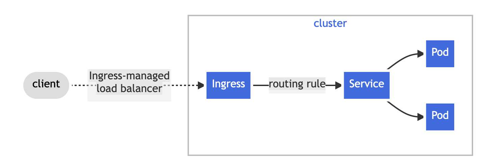

## notes 
1. Ingress rule ---> this object ensures or rather its a rule book which states that which a user what to view a particular microservicce 
the traffic will diverted to that particular microservice cluster IP service object 
2. ingress controller --> ensure that the traffic requested by the user has requested the desired destination 
it will route the trafic to desired destination. 
EX: nginx ingress controller; apache ingress controller ; istio ingress controller ;
- https://kubernetes.io/docs/concepts/services-networking/ingress/




---

## Ingress 
```pod.yaml
apiVersion: v1
kind: Pod
metadata:
  name: mobile-pod
  labels:
    app: nginx
spec:
  containers:
  - name: mobile-container
    image: nginx:latest
    ports:
    - containerPort: 80
```

## expose application withing cluster using clusterip service 

```service.yaml
apiVersion: v1
kind: Service
metadata:
  name: mobile-service
spec:
  type: ClusterIP
  selector:
    app: nginx
  ports:
  - protocol: TCP
    port: 80
    targetPort: 80
```
---
## laptop application 
```pod.yaml
apiVersion: v1
kind: Pod
metadata:
  name: laptop-pod
  labels:
    app: httpd
spec:
  containers:
  - name: laptop-container
    image: httpd:latest
    ports:
    - containerPort: 80
```

```service.yaml
apiVersion: v1
kind: Service
metadata:
  name: laptop-service
spec:
  type: ClusterIP
  selector:
    app: httpd
  ports:
  - protocol: TCP
    port: 80
    targetPort: 80
```


## to expose application with the help of ingress for path based routing 

```ingress.yaml
apiVersion: networking.k8s.io/v1
kind: Ingress
metadata:
  name: app-ingress
spec:
  ingressClassName: nginx
  rules:
  - http:
      paths:
      - path: /mobile
        pathType: Prefix
        backend:
          service:
            name: mobile-service
            port:
              number: 80
      - path: /laptop
        pathType: Prefix
        backend:
          service:
            name: laptop-service
            port:
              number: 80
```
## make shure that you have ingress controller 
- nginx ingress controller for eks
- installation with manifest
```
kubectl apply -f https://raw.githubusercontent.com/kubernetes/ingress-nginx/main/deploy/static/provider/cloud/deploy.yaml

```

```bash
kubectl get pods
kubectl get svc
kubectl get svc -n ingress-nginx
```
---

## 📌 2. Install NGINX Ingress Controller (Manifests)
Apply the official manifest:

```bash
kubectl apply -f https://raw.githubusercontent.com/kubernetes/ingress-nginx/main/deploy/static/provider/cloud/deploy.yaml
```
**Verify installation:**

```sh
kubectl get pods -n ingress-nginx
kubectl get svc -n ingress-nginx
```
### Sample Applications
✅ App1 (Deployment + Service)
```yaml
apiVersion: apps/v1
kind: Deployment
metadata:
  name: app1
spec:
  replicas: 1
  selector:
    matchLabels:
      app: app1
  template:
    metadata:
      labels:
        app: app1
    spec:
      containers:
      - name: app1
        image: hashicorp/http-echo
        args:
        - "-text=Hello from App1"
        ports:
        - containerPort: 5678
---
apiVersion: v1
kind: Service
metadata:
  name: app1-svc
spec:
  selector:
    app: app1
  ports:
  - port: 80
    targetPort: 5678
```
### ✅ App2 (Deployment + Service)
```yaml
apiVersion: apps/v1
kind: Deployment
metadata:
  name: app2
spec:
  replicas: 1
  selector:
    matchLabels:
      app: app2
  template:
    metadata:
      labels:
        app: app2
    spec:
      containers:
      - name: app2
        image: hashicorp/http-echo
        args:
        - "-text=Hello from App2"
        ports:
        - containerPort: 5678
---
apiVersion: v1
kind: Service
metadata:
  name: app2-svc
spec:
  selector:
    app: app2
  ports:
  - port: 80
    targetPort: 5678
```
### Ingress Examples
**✅ Path-based Routing**
```yaml
apiVersion: networking.k8s.io/v1
kind: Ingress
metadata:
  name: path-based-ingress
  annotations:
    nginx.ingress.kubernetes.io/rewrite-target: /
spec:
  ingressClassName: nginx
  rules:
  - http:
      paths:
      - path: /app1
        pathType: Prefix
        backend:
          service:
            name: app1-svc
            port:
              number: 80
      - path: /app2
        pathType: Prefix
        backend:
          service:
            name: app2-svc
            port:
              number: 80
```
**✅ Host/Name-based Routing**
```yaml
apiVersion: networking.k8s.io/v1
kind: Ingress
metadata:
  name: host-based-ingress
spec:
  ingressClassName: nginx
  rules:
  - host: app1.example.com
    http:
      paths:
      - path: /
        pathType: Prefix
        backend:
          service:
            name: app1-svc
            port:
              number: 80
  - host: app2.example.com
    http:
      paths:
      - path: /
        pathType: Prefix
        backend:
          service:
            name: app2-svc
            port:
              number: 80
```
**to ckech annotations**
```sh
kubectl describe ing path-based-ingress
```

